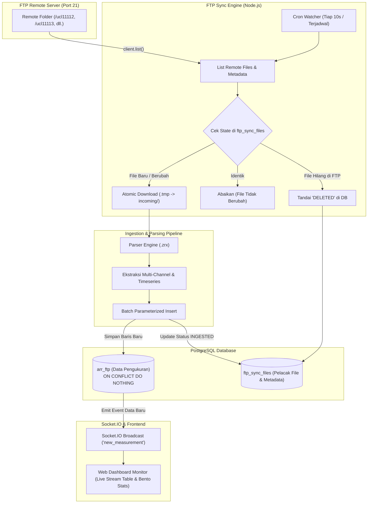

# FTP Data Logger Migration & Realtime System

Sistem backend berbasis **Node.js**, **Express**, **PostgreSQL**, dan **Socket.IO** untuk melakukan sinkronisasi otomatis file log data logger format `.zrx` dari **Server FTP (Port 21)**, parsing data multi-logger & multi-channel, pencegahan duplikasi data (*idempotency*), serta penayangan data secara *realtime* di antarmuka web dashboard.

---

## 🏗️ Arsitektur & Alur Kerja Sistem



---

## ⚡ Fitur Utama

1. **FTP Sync Engine & Delta Detection (`src/services/ftpSyncService.js`)**
   * **Atomic Download**: Mengunduh file dengan ekstensi sementara `.tmp` dan me-rename atomik setelah selesai 100% untuk mencegah *race condition* atau pembacaan file yang belum selesai ditulis.
   * **Deteksi Delta**: Mengidentifikasi apakah file remote berstatus **Baru**, **Berubah** *(ukuran atau waktu modifikasi beda)*, **Dihapus**, atau **Tidak Berubah**.
   * **Dukungan Multi-Folder & Auto-Discovery**:
     * Mendukung pemantauan 1 folder (contoh: `/ucl11112`).
     * Mendukung banyak folder sekaligus via koma (contoh: `/ucl11112, /ucl11113, /ull00506`).
     * Mendukung mode **`ALL`**: Otomatis memindai dan menyinkronkan seluruh folder stasiun logger yang ada di root FTP.

2. **Parser Multi-Logger & Multi-Channel (`src/utils/parser.js`)**
   * Membaca dan memvalidasi format encapsulated logger `.zrx`.
   * Mendeteksi header `#REXCHANGE<id_logger>_<channel>`, `##CDASA`, dan `##CCHANNEL...CUNIT`.
   * Mengonversi format padat timestamp `YYYYMMDDHHmmss` menjadi standar SQL Timestamp `YYYY-MM-DD HH:mm:ss`.
   * Mendukung ragam satuan sensor (seperti `mm`, `mm/min`, dsb.) dalam file yang sama.

3. **Integritas Database & Idempotensi Penuh (`src/services/measurementService.js`)**
   * Menggunakan klausa PostgreSQL:
     ```sql
     INSERT INTO arr_ftp (id_logger, channel, recorded_at, value, unit)
     VALUES (...)
     ON CONFLICT (id_logger, channel, recorded_at) DO NOTHING;
     ```
   * Menjamin data lama tidak akan pernah terduplikasi meskipun file yang sama diunduh ulang atau ditambahkan data baru (*appended*).
   * Seluruh proses dibungkus transaksi ACID (`BEGIN` ... `COMMIT` / `ROLLBACK`).

4. **Background Watcher / Scheduler (`src/services/cronService.js`)**
   * Dijalankan otomatis secara periodik (default setiap 10 detik).
   * Dilengkapi *mutex lock* (`isProcessing`) untuk mencegah *overlapping execution* saat transfer data jaringan berlangsung lama.

5. **Broadcast Realtime & Web Dashboard (`public/index.html`)**
   * Memancarkan event Socket.IO `new_measurement` hanya untuk data yang benar-benar baru masuk ke database.
   * Dilengkapi antarmuka **Clean Editorial Minimalist** dengan dukungan Mode Terang dan Gelap (*Dark Mode*).
   * Metrik live: **Total Baris Database**, **Event Masuk (Sesi Ini)**, **Total File Diambil**, dan **Channel Aktif**.

---

## 📁 Struktur Folder & File

```text
ftp-migration/
├── public/
│   └── index.html               # Web Dashboard monitor live (Socket.IO & statistik)
├── src/
│   ├── config/
│   │   └── db.js                # Koneksi PostgreSQL Connection Pool (pg.Pool)
│   ├── scripts/
│   │   ├── test-db.js           # Uji koneksi DB & verifikasi struktur constraint
│   │   ├── test-ftp.js          # Uji konektivitas port 21 & listing folder FTP
│   │   ├── test-parser.js       # Uji parser dengan file contoh .zrx lokal
│   │   ├── test-insert.js       # Uji batch insert & verifikasi ON CONFLICT
│   │   ├── test-simulation.js   # Uji alur simulasi lokal
│   │   ├── migrate.js           # Migrasi penambahan UNIQUE constraint di arr_ftp
│   │   ├── migrate-sync.js      # Migrasi pembuatan tabel pelacak ftp_sync_files
│   │   ├── initial-sync.js      # Script CLI penarikan penuh semua file dari FTP
│   │   ├── reingest-local.js    # Restore instan data arr_ftp dari file lokal
│   │   ├── reset-demo.js        # Reset total data & file storage untuk demo
│   │   └── generate-mock-file.js # Generator file .zrx mock data segar
│   ├── services/
│   │   ├── ftpSyncService.js    # Engine koneksi, listing, download & sinkronisasi FTP
│   │   ├── ingestionService.js  # Orkestrator parsing, simpan DB, dan Socket.IO
│   │   ├── measurementService.js # Query database transaksi batch & statistik
│   │   └── cronService.js       # Scheduler background otomatis pemantau file
│   ├── utils/
│   │   └── parser.js            # Parser file .zrx (multi-logger & multi-channel)
│   └── index.js                 # Entry point Express API & Server Socket.IO
├── storage/
│   └── ftp_simulator/
│       ├── incoming/            # Folder staging file masuk
│       ├── processed/           # Arsip file yang sukses diproses
│       └── failed/              # Arsip file yang rusak/gagal diproses
├── .env                         # Konfigurasi credential rahasia (diabaikan git)
├── .env.example                 # Template konfigurasi environment
├── .gitignore                   # Pencegahan commit file rahasia & file data .zrx
└── package.json                 # Dependensi & NPM scripts
```

---

## 🗄️ Skema Database

### 1. Tabel `arr_ftp` (Data Pengukuran Timeseries)
```sql
CREATE TABLE arr_ftp (
    id BIGINT GENERATED ALWAYS AS IDENTITY PRIMARY KEY,
    id_logger VARCHAR(50) NOT NULL,
    recorded_at TIMESTAMP NOT NULL,
    channel VARCHAR(20) NOT NULL,
    value NUMERIC(12, 4),
    created_at TIMESTAMP DEFAULT CURRENT_TIMESTAMP,
    unit VARCHAR(20),
    CONSTRAINT uq_arr_ftp_logger_channel_recorded UNIQUE (id_logger, channel, recorded_at)
);
```

### 2. Tabel `ftp_sync_files` (Pelacak Sinkronisasi File)
```sql
CREATE TABLE ftp_sync_files (
    id BIGINT GENERATED ALWAYS AS IDENTITY PRIMARY KEY,
    remote_path VARCHAR(255) NOT NULL,
    filename VARCHAR(255) NOT NULL,
    file_size BIGINT NOT NULL,
    remote_modified_at TIMESTAMP NOT NULL,
    sync_status VARCHAR(50) DEFAULT 'SYNCED', -- 'SYNCED', 'INGESTED', 'DELETED', 'FAILED'
    last_synced_at TIMESTAMP DEFAULT CURRENT_TIMESTAMP,
    last_error TEXT NULL,
    CONSTRAINT uq_ftp_sync_remote_file UNIQUE (remote_path, filename)
);
```

---

## ⚙️ Konfigurasi Environment (`.env`)

Salin file `.env.example` menjadi `.env` lalu sesuaikan isinya:

```env
# Application
PORT=3000
NODE_ENV=development

# PostgreSQL Database
DB_HOST=localhost
DB_PORT=5432
DB_USER=postgres
DB_PASSWORD=password_postgres_anda
DB_NAME=ftp_migration

# FTP Configuration
FTP_ENABLED=true
FTP_HOST=103.149.208.24
FTP_PORT=21
FTP_USER=username_ftp
FTP_PASSWORD=password_ftp
FTP_SECURE=false
FTP_TIMEOUT=30000

# Folder Target Remote di FTP
# Pilihan 1: Satu folder     -> /ucl11112
# Pilihan 2: Banyak folder   -> /ucl11112, /ucl11113, /ull00506
# Pilihan 3: Semua folder    -> ALL
FTP_REMOTE_DIR=/ucl11112

# Watcher Schedule (Default: per 10 detik)
CRON_SCHEDULE=*/10 * * * * *
```

---

## 🚀 Panduan Instalasi & Menjalankan Sistem

### 1. Clone & Pasang Dependensi
```bash
git clone https://github.com/lipp13/ftp-migration.git
cd ftp-migration
npm install
```

### 2. Setup Database & Jalankan Migrasi
Pastikan PostgreSQL sudah berjalan dan database telah dibuat, kemudian jalankan migrasi tabel:
```bash
# Tambah constraint unik anti-duplikasi ke tabel arr_ftp
node src/scripts/migrate.js

# Buat tabel pelacak sinkronisasi ftp_sync_files
npm run migrate:sync
```

### 3. Uji Koneksi
```bash
# Uji koneksi ke database PostgreSQL
npm run test:db

# Uji koneksi ke Server FTP (Port 21)
npm run test:ftp
```

### 4. Tarik Seluruh File Awal (*Initial Sync*)
Untuk mengunduh dan memproses ribuan file historis yang sudah ada di FTP dengan progres live di terminal:
```bash
npm run sync:initial
```
*(Bisa menggunakan opsi batasan untuk uji coba, contoh: `npm run sync:initial -- --limit=10`)*.

### 5. Jalankan Server Utama
```bash
npm run dev
```
Buka browser di **`http://localhost:3000`** untuk melihat Web Dashboard monitor secara *realtime*.

---

## 📋 Daftar Perintah Terminal (NPM Scripts)

| Perintah | Deskripsi |
| :--- | :--- |
| `npm run dev` | Menjalankan server Express, Socket.IO, dan Cron Watcher otomatis |
| `npm start` | Menjalankan server dalam mode produksi |
| `npm run test:db` | Menguji koneksi database & integritas tabel |
| `npm run test:ftp` | Menguji koneksi port 21, otentikasi FTP, dan listing folder |
| `npm run test:parser` | Menguji modul parser membaca struktur file `.zrx` |
| `npm run test:insert` | Menguji mekanisme batch insert & penolakan data duplikat |
| `npm run test:sim` | Menjalankan simulasi lokal alur *incoming* &rarr; *processed* |
| `npm run migrate:sync` | Membuat tabel pelacak sinkronisasi `ftp_sync_files` |
| `npm run sync:initial` | Menarik seluruh file dari FTP server dengan progres persen |
| `npm run restore:local` | Me-restore cepat data `arr_ftp` dari file lokal yang sudah tersimpan (hanya ~5 detik) |
| `npm run reset:all` | Mengosongkan data dan membersihkan storage untuk keperluan rekaman/demo baru |

---

## 🔌 Dokumentasi REST API

| Method | Endpoint | Deskripsi |
| :--- | :--- | :--- |
| `GET` | `/health` | Status kesehatan backend dan uptime server |
| `GET` | `/api/db-check` | Pengecekan koneksi pool PostgreSQL |
| `GET` | `/api/stats` | Statistik total baris data, total file, stasiun logger, dan rentang tanggal |
| `GET` | `/api/measurements` | Riwayat data pengukuran dengan query parameter `?id_logger=&channel=&limit=50&offset=0` |
| `POST` | `/api/simulate-fresh` | Membuat file mock `.zrx` baru dengan data acak terkini di folder `incoming` |
| `POST` | `/api/simulate-drop` | Menyalin file sampel `.zrx` asli untuk pengujian *duplicate prevention* |

---

## 🛡️ Keamanan & Catatan Repositori
* File [`.gitignore`](.gitignore) telah mengabaikan file `.env` dan seluruh file `.zrx` (`storage/ftp_simulator/incoming/*`, `processed/*`, `failed/*`).
* Kredensial server FTP dan database PostgreSQL aman dari kebocoran ke repositori publik.
* Struktur folder lokal tetap dipertahankan menggunakan file penanda `.gitkeep`.
